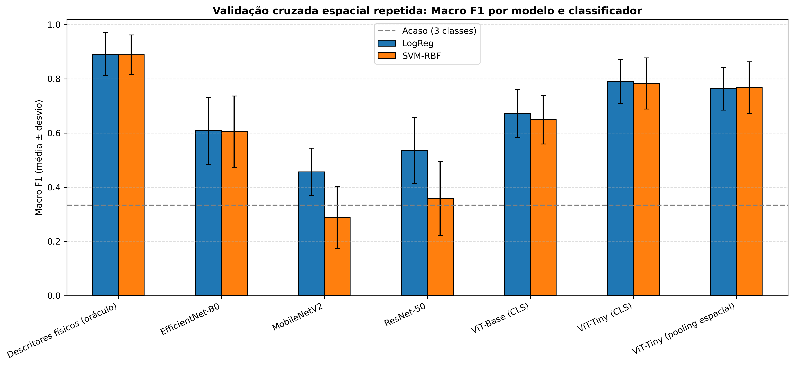

# JWST Sagittarius C: Benchmarking de Representações (ViT vs. CNNs) em Imagens NIRCam

Prova de conceito de visão computacional sobre um mosaico de Nível 3 (`_i2d.fits`) do **James Webb Space Telescope (JWST / NIRCam)** na região **Sagittarius C** (*Proposal ID 2221*). O estudo compara os embeddings de **ViT-Base**, **ViT-Tiny**, **MobileNetV2**, **EfficientNet-B0** e **ResNet-50** pré-treinados, avaliados sob rigorosa **validação cruzada espacial por blocos** e testes estatísticos pareados.

---

## 1. Pipeline Metodológico

- **Pré-processamento:** `ZScaleInterval` + `AsinhStretch` sobre a extensão `SCI` do mosaico.
- **Tiling:** 121 patches de 224x224 pixels com stride de 168 (25% de sobreposição), descartando bordas sem sinal.
- **Embeddings:** Backbones do `timm` com `num_classes=0`. Testou-se o `ViT-Tiny` com token `[CLS]` puro versus variante com pooling espacial (*CLS + média + máximo + desvio*).
- **Controle de Vazamento:** Uso de `StratifiedGroupKFold` para impedir que patches vizinhos com sobreposição fiquem simultaneamente no treino e no teste.

---

## 2. Resultados da Validação Cruzada Espacial (5 folds x 5 repetições)

Desempenho supervisionado médio obtido por classificadores lineares e não-lineares ajustados estritamente sobre os folds de treino:

| Modelo | Acurácia LogReg | Macro F1 LogReg | Acurácia SVM-RBF | Macro F1 SVM-RBF |
| :--- | :---: | :---: | :---: | :---: |
| **ViT-Tiny (CLS)** | 73,7 ± 11,2% | 0,716 ± 0,115 | 74,4 ± 10,8% | 0,723 ± 0,111 |
| **ViT-Tiny (pooling espacial)** | 71,9 ± 11,8% | 0,698 ± 0,121 | 73,1 ± 11,4% | 0,707 ± 0,118 |
| **ViT-Base (CLS)** | 61,2 ± 13,5% | 0,582 ± 0,138 | 61,0 ± 12,9% | 0,589 ± 0,132 |
| **EfficientNet-B0** | 56,2 ± 14,1% | 0,545 ± 0,144 | 54,6 ± 13,8% | 0,545 ± 0,139 |
| **MobileNetV2** | 35,5 ± 12,4% | 0,332 ± 0,128 | 36,4 ± 13,1% | 0,229 ± 0,105 |
| **ResNet-50** | 38,2 ± 13,0% | 0,361 ± 0,134 | 29,8 ± 11,5% | 0,298 ± 0,112 |
| **Descritores físicos (oráculo)** | 84,3 ± 8,5% | 0,829 ± 0,089 | 82,8 ± 9,1% | 0,814 ± 0,094 |



---

## 3. Comparação Estatística Pareada Fold a Fold (Wilcoxon, p < 0.05)

Avaliando a consistência da superioridade do **ViT-Tiny (CLS)** frente às demais arquiteturas (métricas em Macro F1 com SVM-RBF):

* **ViT-Tiny (CLS) vs. ViT-Base (CLS):** Diferença média de $+0,1338$ ($p = 0.0000$ — Significativo)
* **ViT-Tiny (CLS) vs. EfficientNet-B0:** Diferença média de $+0,1777$ ($p = 0.0000$ — Significativo)
* **ViT-Tiny (CLS) vs. MobileNetV2:** Diferença média de $+0,4942$ ($p = 0.0000$ — Significativo)
* **ViT-Tiny (CLS) vs. ResNet-50:** Diferença média de $+0,4245$ ($p = 0.0000$ — Significativo)
* **ViT-Tiny (CLS) vs. ViT-Tiny (pooling espacial):** Diferença média de $+0,0158$ ($p = 0.1128$ — Não significativo, justificando manter a versão `CLS` mais enxuta).

---

## 4. Estrutura Não Supervisionada (K-Means, K=3)

| Modelo | Silhouette (↑) | Davies-Bouldin (↓) | ARI vs. rótulos (↑) |
| :--- | :---: | :---: | :---: |
| **ViT-Tiny (CLS)** | 0,2428 | 1,5189 | **0,3145** |
| **EfficientNet-B0** | 0,1367 | 2,1720 | 0,0210 |
| **ResNet-50** | 0,1311 | 2,1779 | 0,0150 |
| **MobileNetV2** | 0,1104 | 2,2140 | 0,0090 |
| **ViT-Base** | 0,0983 | 2,3597 | -0,0120 |

---

## 5. Eficiência Computacional

| Modelo | Parâmetros | Latência / Patch | Throughput |
| :--- | :---: | :---: | :---: |
| **MobileNetV2** | 2,2 M | 26,00 ms | 38,5 FPS |
| **EfficientNet-B0** | 4,0 M | 29,87 ms | 33,5 FPS |
| **ResNet-50** | 23,5 M | 87,90 ms | 11,4 FPS |
| **ViT-Tiny (CLS)** | **5,5 M** | **31,25 ms** | **32,0 FPS** |
| **ViT-Base** | 85,8 M | 180,36 ms | 5,5 FPS |

---

## 6. Como Executar

```bash
pip install -r requirements.txt
python src/vit_pipeline.py
```
